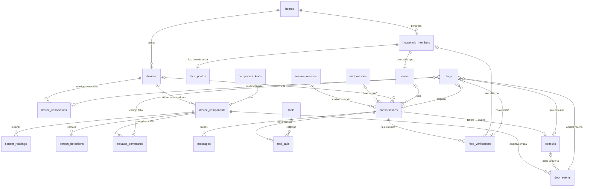

# Base de datos · IOTEAM Jarvis

PostgreSQL 17 (el mismo motor que ya usa el backend). 21 tablas en 6 bloques, normalizada a **3FN**
y alineada con la lógica que ya existe en `app/backend/src`.

| Archivo | Para qué |
|---|---|
| `schema.sql` | Crea tablas, catálogos y vistas (probado en Postgres 17) |
| `metrics.sql` | Indicadores del documento, reconocimiento facial, consultas y flags |
| `jarvis-erd.drawio` | Diagrama ER para Lucidchart / draw.io (tablas con columnas, PK/FK y relaciones, por bloques de color) |
| `jarvis-erd.mmd` | El mismo diagrama en Mermaid |
| `lucidchart-import.csv` | Alternativa: importar como datos de PostgreSQL en Lucidchart |

## Diagrama

## Cómo refleja el código

| Lógica del backend | Dónde vive en la base |
|---|---|
| Token `jdv_` + 24 bytes; se guarda solo `sha256` y los primeros 8 caracteres (`devices.service.ts`) | `devices.token_hash` (`CHAR(64)`, hex, único) y `devices.token_prefix` (`jdv_xxxx`); `token_rotated_at` al rotar |
| La placa entra por `/devices` (voz) y `/camera` (JPEG) | `device_connections.channel` = `voice` / `camera`. Reemplaza el parche `firmware_version = 'camera'` |
| `status` offline/idle/in_call, `last_seen_at`, versión de firmware | Se **deducen** en `v_devices` de las conexiones y sesiones abiertas |
| Roster de la casa, roles `owner` / `resident`, upsert por nombre | `household_members` con `UNIQUE (home_id, name)` |
| Foto JPEG/PNG ≤ 5 MB (límite de Rekognition) | `face_photos`: `CHECK` de tamaño y de los bytes mágicos. El mime se deduce en `v_face_photos` |
| `verify_owner_face`: compara contra los `owner`, umbral 90 %, máx. 3 intentos, 7 resultados | `face_verifications` (resultado, similitud, umbral vigente, cámara, persona que coincidió); `homes.face_match_threshold` |
| `reason === 'button' ? 'doorbell' : 'assistant'`; el dueño contesta con sesión `security` | Catálogo `session_reasons` (motivo → modo) |
| Motivos de cierre (`client_end`, `openai_error`, `server_shutdown`...) | Catálogo `end_reasons` (motivo → resultado) |
| Consulta timbre → dueño con UUID y estados `ringing`...`visitor_left`; interfón | `consults` (une la sesión del timbre con la del dueño) |
| `instruct_doorbell` (la decisión del dueño es texto libre) | Mensaje `sender = 'owner'` en la conversación del timbre |
| Herramientas de las skills | Catálogo `tools` (herramienta → skill) y `tool_calls` |

**Lo que hoy solo vive en memoria y con esto se guarda:** los intentos de reconocimiento facial, las consultas al dueño, las conversaciones y las conexiones de las placas.

## Normalización

**1FN.** Cada columna guarda un solo valor; no hay listas ni grupos repetidos (cada mensaje, intento, lectura o evento es su propio renglón); toda tabla tiene llave primaria. `tool_calls.arguments/result` guardan el JSON de OpenAI como un solo documento, sin campos que se consulten por separado.

**2FN.** Todas las llaves primarias son de una sola columna, así que no hay dependencias parciales.

**3FN.** Ninguna columna no-llave depende de otra no-llave:

| Dato | Depende de | Solución |
|---|---|---|
| Nombre y hogar de un usuario | La persona | Solo en `household_members`; `users.member_id` |
| Sensor/actuador y unidad | Tipo de componente | Catálogo `component_kinds` |
| Modo de la sesión | Motivo | Catálogo `session_reasons` |
| Resultado de la sesión | Motivo de cierre | Catálogo `end_reasons` |
| Skill de una herramienta | Herramienta | Catálogo `tools` |
| Mime de la foto | Bytes de la foto | Vista `v_face_photos` |
| Estado, última conexión y firmware de la placa | Conexiones/sesiones abiertas | Vista `v_devices` |
| Hogar de una sesión o de un flag | Su dispositivo/usuario/causa | Vistas `v_conversations`, `v_flags` |
| Tiempo que la puerta estuvo abierta | Otro renglón | Vista `v_door_open_periods` |

Las reglas de negocio se hacen cumplir con `CHECK`. Por ejemplo: un `match` siempre dice con quién coincidió; un flag tiene exactamente una causa; no hay interfón sin que el dueño haya contestado.

## Importar a Lucidchart

1. **Archivo → Importar** y sube `jarvis-erd.drawio` (formato Draw.io). Si prefieres, también acepta `jarvis-erd.mmd` (Mermaid).
2. Las 21 tablas llegan acomodadas en 5 columnas de colores, una por bloque, con sus 37 relaciones.

Ambos archivos se generaron desde el esquema aplicado en Postgres, así que coinciden columna por columna con `schema.sql`. Las vistas (`v_*`) no aparecen porque no son tablas.

## Para usarla en el backend

Hace falta convertirla en migraciones de Sequelize. Cambios en el código actual:
- `devices`: quitar `status`, `last_seen_at` y `firmware_version` (pasan a `device_connections`) y registrar cada conexión y desconexión en los gateways.
- `household_members`: mover la foto a `face_photos`; el mime ya lo calcula `detectImageMime`.
- Guardar en sus tablas lo que hoy vive en memoria: `FaceVerificationService`, `ConsultService` y `RealtimeWsBridgeService`.
